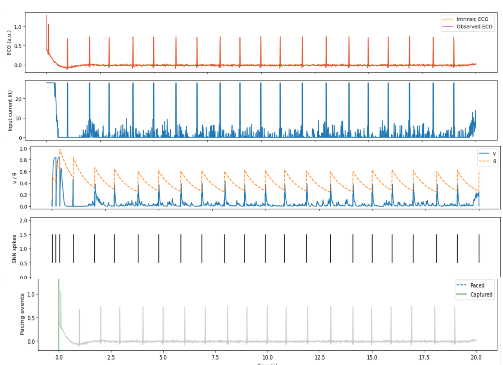
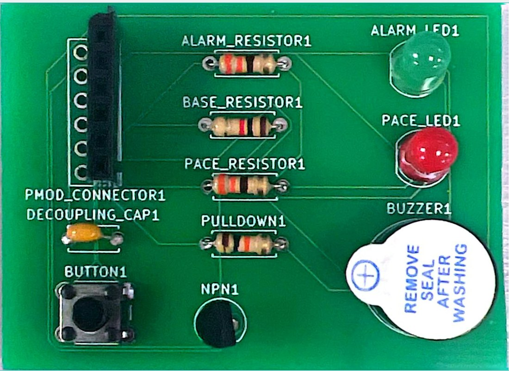
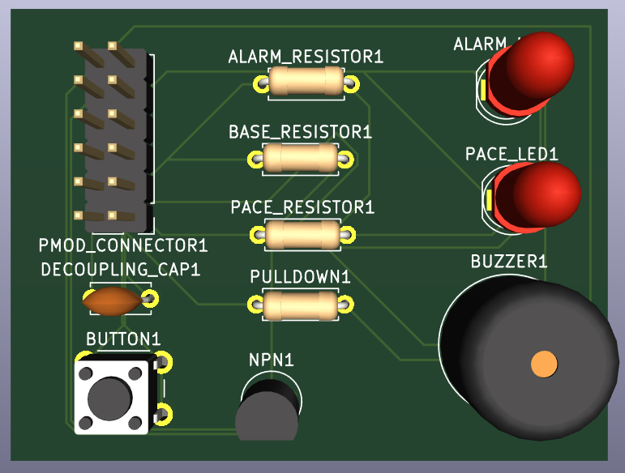
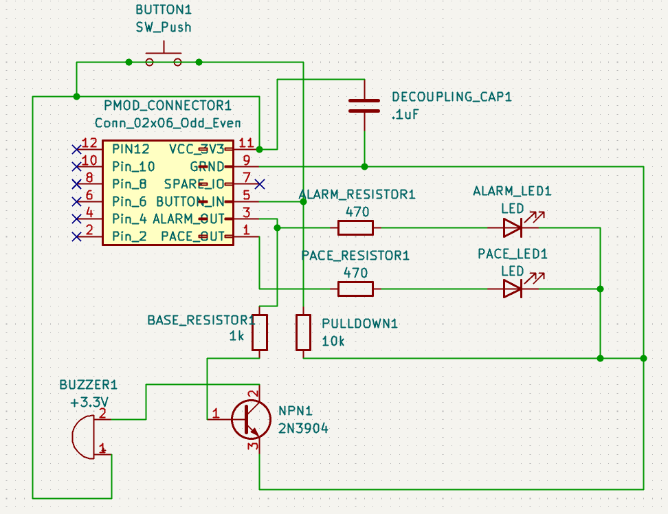
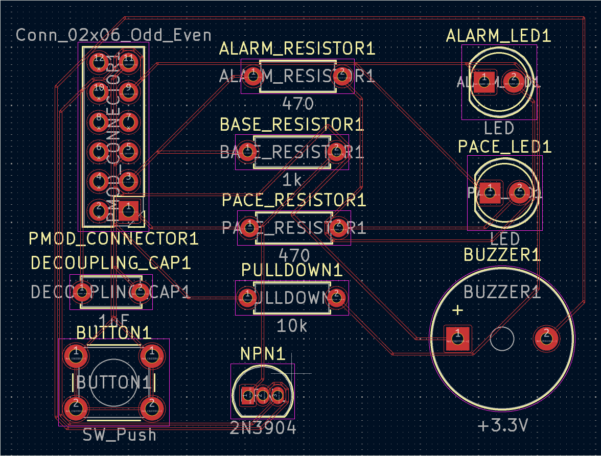

# Dual-Chamber Digital Pacemaker with Adaptive LIF Sensing (Verilog, Nexys A7)

A digital pacemaker in Verilog for the Digilent Nexys A7-100T (Artix-7). Two adaptive leaky
integrate-and-fire (LIF) neurons sense the atrial and ventricular channels, and a DDD-style controller paces
whichever chamber needs it. A self-checking SystemVerilog testbench with an independent reference model,
protocol checks and fault injection verifies it. The project also includes a custom KiCad PCB that plugs into
the board's PMOD header.

> Educational model only. Not a medical device.

## Architecture

```
                     +-> adaptive_lif (atrial) ----+
ecg_gen (2 channels) |                              +-> pacemaker_ctrl --> AS  AP  VS  VP
                     +-> adaptive_lif (ventricular)-+
```

All logic runs from the 100 MHz board clock. A divider makes a one-clock 1 kHz sample enable (one "tick" = 1 ms),
and every register updates only on a tick.

| Module | Role |
| --- | --- |
| `adaptive_lif` | One per chamber. Subtracts the baseline, rejects samples inside a +/-100 dead zone, integrates with a `v >> 4` leak, saturates instead of wrapping, and fires when `v >= theta`. The threshold `theta` jumps by 128 after a spike and decays back, and a 3-tick refractory counter blocks re-firing |
| `pacemaker_ctrl` | Dual-chamber controller (below) |
| `pacemaker_core` | Two detectors plus the controller. This is what the testbench drives |
| `ecg_gen` | Synthetic two-channel ECG with four scenarios chosen by the board switches |
| `pacemaker_top` | Clock divider, ECG generator, core, and LED stretching for the board |

### Pacing logic

| Event | Meaning |
| --- | --- |
| AS / VS | Atrial / ventricular beat sensed |
| AP / VP | Atrial / ventricular pace |

| Timer | Default | Rule |
| --- | --- | --- |
| Lower rate interval | 1000 ticks (60 BPM) | The ventricle is never left unstimulated longer than this |
| AV delay | 150 ticks | After an atrial event, VP fires if no VS arrives in time |
| PVARP | 250 ticks | Atrial sensing ignored after a ventricular event |
| VRP | 200 ticks | Ventricular sensing ignored after a ventricular event |
| Atrial blanking | 40 ticks | Atrial channel blanked after AP |
| Crosstalk blanking | 20 ticks | Ventricular channel blanked after AP |

After a ventricular event the controller waits for an atrial beat (AS). If none arrives within
`LRI - AV` ticks it paces the atrium (AP). Either atrial event starts the AV delay, and VP fires when it
expires unless the heart conducts on its own (VS).

## Board demo

`SW[1:0]` picks the scenario and LD0 to LD3 show AS, VS, AP, VP (each stretched to 100 ms so it is visible).

| SW[1:0] | Scenario | What you should see |
| --- | --- | --- |
| 00 | Normal sinus rhythm, 75 BPM | LD0 and LD1 blink, no pacing |
| 01 | Sinus arrest (beats stop for 7 of every 12) | Pacing takes over at 60 BPM: LD2 then LD3 |
| 10 | AV block (P waves, no QRS) | LD0 then LD3 every beat |
| 11 | Sinus rhythm with noise | Same as 00, noise is rejected |

## Verification

Run everything from the repository root, or add the files in Vivado (below).

```bat
sim\run_xsim.bat                      :: self-checking core testbench, all tests
sim\run_xsim.bat tb_top_demo          :: board-level demo scenarios
python sim\regress.py                 :: clean build + every injected fault, writes sim\regress\report.md
```

[`tb/tb_pacemaker.sv`](tb/tb_pacemaker.sv) checks the core in three independent ways:

1. **Reference model.** A behavioral copy of the detectors and controller runs alongside the DUT, and every
   output is compared on every tick.
2. **Protocol checks** on the DUT outputs alone: lower rate never violated, AP exactly `LRI - AV` after a
   ventricular event, VP exactly one AV delay after an atrial event, nothing sensed inside PVARP or VRP, paced
   V-V interval equals the lower rate, and no two pacing events in one tick.
3. **Directed tests** with hand-computed expectations: sinus rhythm (pacing stays inhibited), sinus arrest,
   AV block, noise rejection, refractory periods, and crosstalk blanking.

Plus a 60,000-tick constrained-random test (random P and QRS presence and timing, stray beats, noise up to
the dead zone, and crosstalk injected after atrial paces) with coverage checks that every event type and
every blocking case occurred.

### Results

- Six directed tests and one 60,000-tick random test: 90,500 per-tick comparisons against the reference model
  and protocol checks, 0 errors
- [`docs/regression-report.md`](docs/regression-report.md): the clean build passes every run, and each of the five
  injected faults (`FI_AV`, `FI_PVARP`, `FI_AP_EARLY`, `FI_NODZ`, `FI_XBLANK`) is caught, so the checkers are
  shown to fail when the design is wrong
- `tb_top_demo` passes all four board scenarios

### Run in Vivado

1. Create a project for part `xc7a100tcsg324-1` (Nexys A7-100T)
2. Add `rtl/pacemaker.v` as a design source and `tb/tb_pacemaker.sv` (and optionally `tb/tb_top_demo.sv`) as
   simulation sources; add `constraints/nexys_a7.xdc` as constraints
3. Set `tb_pacemaker` as the simulation top and run all. The Tcl console ends with `TEST PASSED`

## FPGA build

Top module `pacemaker_top`. `sim/synth/impl.tcl` runs synthesis, place and route for the Nexys A7-100T:

- 743 LUTs, 389 registers (about 1% of the device)
- Timing met after routing at 100 MHz (WNS +4.9 ns)
- The constraints declare the sample-domain logic as multicycle, since it updates once per 100,000 clocks
- The bitstream and the dual-chamber version on the physical board are not yet exercised; the earlier
  single-chamber version ran on the board

## Bug found and fixed in the original version

The original single-chamber controller never received the detector's beats. The detector's spike was a one-clock
pulse that began the clock after the one-clock sample enable, so the controller, which looked for a spike only
while the enable was high, never saw one. In a 3-second simulation (sample tick sped up) the original design
detected 750,001 beats and still paced 7,493 times, once every escape interval. In the rewrite, every register updates only on the sample tick and
every output is held for a whole tick, and the testbench verifies the controller inhibits pacing when beats
arrive. The rewrite also adds saturation to the detector's accumulator, which previously could wrap around on a
sustained negative input.

## Adaptive-threshold detector behavior

The detector is an adaptive LIF neuron: the membrane voltage `v` integrates the ECG, and the firing threshold
`theta` jumps after every beat and decays back, so a beat is detected once and noise is not. This plot is from a
Python model of the detector (ECG input, input current, `v` against `theta`, detected spikes, pacing events):



## PCB integration

The original single-chamber design was extended with a custom KiCad PCB (2-layer, PMOD-compatible) with a pace
LED, an alarm LED, a buzzer driven by a 2N3904, a pushbutton with a 10 kohm pulldown, and a decoupling
capacitor. [`hardware/pacemaker_led_demo.v`](hardware/pacemaker_led_demo.v) is the simple Verilog that drove
that board. See the [`docs`](docs) folder for the presentations and reports from each course.

<p>
  
  
</p>
<p>
  
  
</p>

Fabricated board, KiCad 3D render, schematic, and routed layout.

## Repository layout

```
rtl/pacemaker.v          detectors, controller, ECG generator, board top
tb/tb_pacemaker.sv       self-checking testbench (model, protocol checks, directed, random)
tb/tb_top_demo.sv        board-level scenarios
constraints/             Nexys A7 pins and timing
sim/run_xsim.bat         xsim run script
sim/regress.py           regression with fault injection
sim/synth/               Vivado synthesis and implementation scripts
hardware/                Verilog used with the PCB
docs/                    reports and presentations (VLSI design, junior design, embedded systems)
```

## Authors

Justice Rebrovich, University of North Dakota (B.S. Electrical Engineering). The PCB and embedded-systems work
was done with Tyler Olsen.
